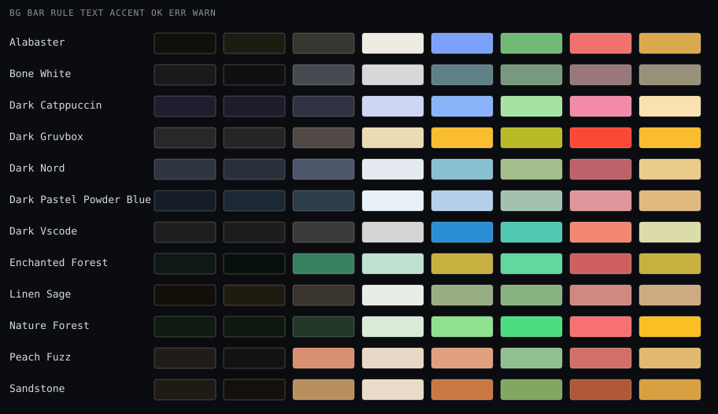
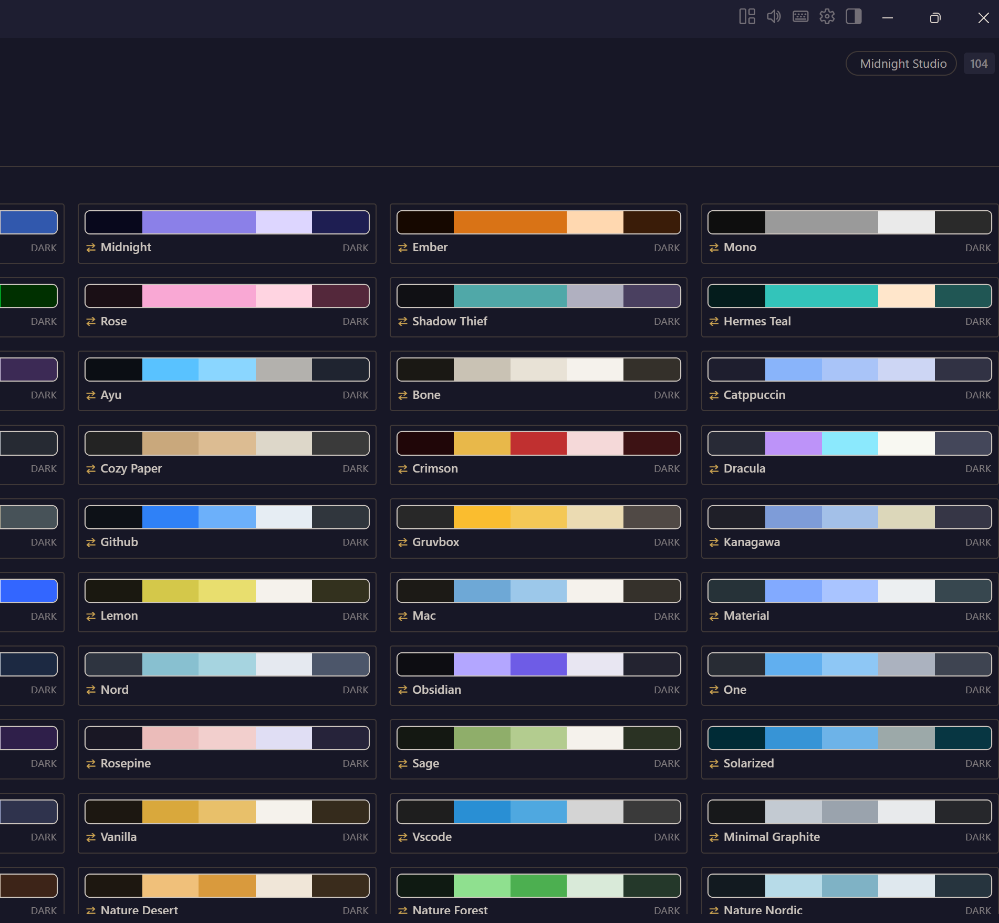

<p align="center">
  
</p>

<h1 align="center">Chroma for Hermes</h1>

<p align="center">
  <a href="https://github.com/TobiasDraven/chroma-for-hermes/actions/workflows/ci.yml"></a>
  <a href="LICENSE"></a>
  
  
  
  
</p>

<p align="center">
  <em>94 skins, each with a light and a dark palette — plus optical typography,<br>
  seven packs, and one-click import from TweakCN and VS Code.</em>
</p>

A theme picker plugin for [Hermes Desktop](https://github.com/NousResearch/hermes), and a hard fork of
[jdtimothy/hermes-theme-picker](https://github.com/jdtimothy/hermes-theme-picker) (MIT).

---

## What you get

- **94 skins, 188 palettes.** Every skin ships a light and a dark palette; the picker
  swaps between them without reloading the app. Skins are grouped into seven packs:
  Core, Studio, Noir, Retro, Cyberpunk, Zen and Earth.
- **Type, not just colour.** Each skin carries its own typography map — family, size,
  weight, letter-spacing — applied to the same surfaces as the palette.
- **Your own skins.** Edit colours and type in the picker, save the result as an owned
  skin, or fork a bundled one and keep both. Owned skins are files you can back up and
  carry between machines.
- **Import what you already use.** TweakCN presets and VS Code colour themes convert
  into skins, with every text role checked against its background at 4.5:1.
- **Packs in and out.** Export a selection as a pack and import it elsewhere. Deletes
  move to a trash you can restore from, and a global cap refuses runaway imports with a
  clear message instead of filling the disk.

<p align="center">
  
  <br>
  <sub>Twelve of the 94, dark palette of each: background, status bar, border, text,
  accent, ok, error, warn.</sub>
</p>

<p align="center">
  
  <br>
  <sub>The picker in Hermes Desktop. Search, filter by mode, and apply without leaving the app.</sub>
</p>

## Install

Hermes Desktop → **Capabilities** → **Plugins** → **Install**, then paste:

```
https://github.com/TobiasDraven/chroma-for-hermes#chroma
```

The plugin package is the `chroma/` subdirectory of this repository. The catalog installs that
subdirectory and the host sparse-clones only it, so the rest of this repo is not shipped.

> Install the SUBDIRECTORY, not the repository root. A bare repo URL has no `plugin.yaml`
> and no `desktop/plugin.js` at its root, so the installer correctly reports
> "no plugin found in this directory". Either form below works:
>
> - `https://github.com/TobiasDraven/chroma-for-hermes#chroma`
> - `https://github.com/TobiasDraven/chroma-for-hermes/tree/main/chroma`

Platform installers for the plugin and its gateway transports live in `chroma/install/`:
`install-windows.cmd`, `install-macos.command`, and `install-gateway-skins.sh`.

## Browse the catalogue

`docs/gallery.html` renders every skin, light and dark, on one page. GitHub shows it as
source — download the file and open it in a browser to see the swatches.

## Repository layout

```
chroma/                    the shipped plugin package (what the catalog installs)
  plugin.yaml              manifest: id, version, entry points
  __init__.py              agent-plugin entry point
  README.md                this file's user-facing sibling
  LICENSE
  THIRD_PARTY_NOTICES.md   MIT credits for every idea copied from another project
  desktop/
    plugin.template.js     SOURCE OF TRUTH: the whole renderer plugin
    plugin.js              GENERATED from the template — never edit by hand
  dashboard/
    plugin_api.py          FastAPI backend: skins, import, export, trash
    manifest.json           the backend half's manifest
  install/                 platform installers for the plugin and its gateway transports
skins-v2/                  the catalogue: one file per skin, both palettes (a build input)
gateway-skins/             mode-locked transports, generated from the catalogue (a build output)
scripts/                   regenerate, package checks, analysis
tests/                     node:test suites + helpers; fixtures/ holds pinned parity data
docs/                      SPEC, ARCH, DECISIONS, TASKS, plans
  chroma-banner.png        the banner above
  palette-strip.svg        the palette strip above
  gallery.html             every skin on one page
  screenshots/             product screenshots used on this page
VERSION                   version, mirrored into plugin.yaml
CHANGELOG.md
AGENTS.md                  the working contract for agents in this repository
DELEGATEDAGENTS.md         the operational handbook, edited freely
rigour.yml                quality gates; committed; never tuned to make a check pass
```

## Development

```bash
python scripts/regenerate.py                              # after EVERY edit to the template
"/c/Program Files/nodejs/node" --test tests/*.test.mjs    # JS suite
pytest                                                    # Python suite
python scripts/check-package.py                           # package contract
python scripts/check-packs.py                             # pack contract
hermes plugins validate chroma                            # host admission gate
```

Use the **system** node for the syntax check. The Hermes-bundled node is first on `PATH` and its
`node --test` reports "stdin is not a tty".

## Licence

MIT — see `LICENSE`. Chroma is a hard fork of
[jdtimothy/hermes-theme-picker](https://github.com/jdtimothy/hermes-theme-picker) (MIT), with the
picker, the backend and the catalogue rebuilt around skins rather than transient themes.
Third-party ideas and copied code are credited in `THIRD_PARTY_NOTICES.md`.